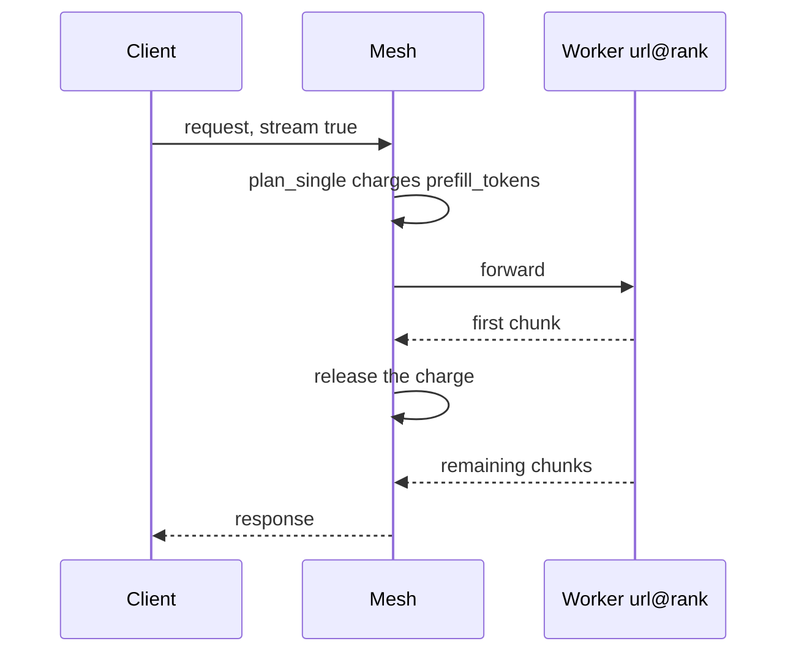
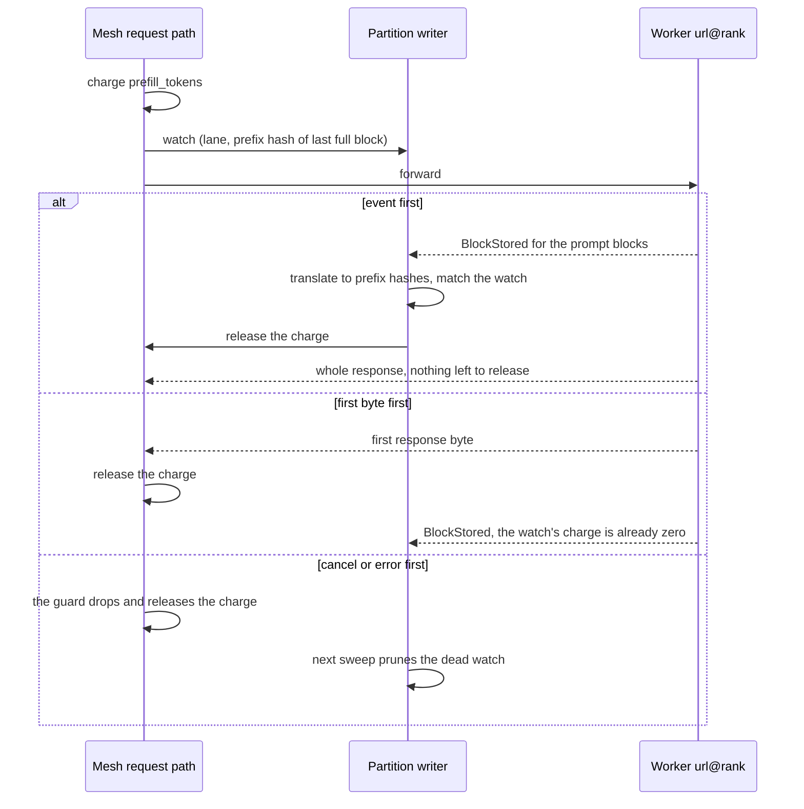
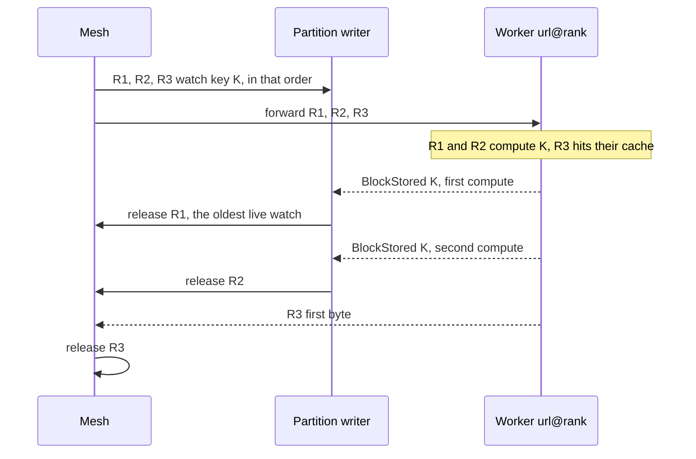

# Prefill charge on every single-worker path

`agentic` scores a worker by the prompt tokens charged to it whose prefill has
not finished (`mesh_worker_prefill_tokens`, see [agentic routing](agentic_cost.md)).
Today only HTTP P/D prefills and streaming HTTP requests are charged. This
design charges a request routed to a single worker (url@rank) on HTTP, ext-proc
and gRPC, streaming or not, and says what releases each charge. The requirement
is MengqingCao/ATOM#16; non-streaming release follows
[llm-d/llm-d-router#3975](https://github.com/llm-d/llm-d-router/pull/3975).

## Scenarios

### Streaming, every path

The charge is taken at routing and released at the first response chunk, as
streaming HTTP already does (`routers/comm/proxy_body.rs: ProxyBody`).

| Path | First chunk seen at | Cancel or error |
| --- | --- | --- |
| HTTP | `ProxyBody::poll_frame`, first frame (unchanged) | the guard drops with the body |
| ext-proc | `RequestLifecycle::body`, first `ResponseBody` message | the guard drops with the lifecycle |
| gRPC | `TokenHandle`'s first item | the guard drops with the body, or on a dispatch error before it |

### Non-streaming, worker with KV events

The charge is released when the selected rank's KV events store the request's
last full prompt block. ATOM publishes a block after the forward that computed
it (`atom/model_engine/block_manager.py: BlockManager.hash_blocks`), so that
store marks the prefill's end.

Each release swaps the shared charge to zero (Decision 4), so whichever comes
second releases nothing.

### Non-streaming, no matching event

The first response byte releases the charge, as for streaming. This covers:

| Case | Why no event matches |
| --- | --- |
| Cached repeat | The engine publishes only blocks it computed (`hash_blocks` starts at `num_cached_tokens`). |
| Prompt shorter than one block | No full block; no watch is registered. |
| Worker with no KV event subscription | No lane to watch, including every gRPC worker: `core/steps/worker/local/follow_kv_events.rs: FollowKvEventsStep` follows HTTP workers only. |
| Rank the engine chose itself | Messages and Responses without the `mesh.apis` label: the store lands on another rank's lane. |
| Media prompt, LoRA, unknown parent, lost batch | The event is dropped (`kv_events/model.rs: DropReason`) or never arrives. |
| Router and engine tokens differ | The prefix hashes differ, as they do for `cache_aware`. |

On a cached repeat `agentic` charged only the uncached tokens, so what is held
to the first byte is at most the tail it had to prefill.

### Identical concurrent prompts on one rank

All requests watch the same key. Each computing request makes the engine
publish its own `BlockStored`, and each stored block releases one live watch,
oldest first. A request that hit the other's cache publishes nothing and falls
back to its first byte.

The event names no request, so a store releases the oldest live watch
whichever of R1 and R2 computed it; after both stores, both watches are
released.

## Decisions

1. **Charge non-streaming in the planner.** `core/placement/planner.rs:
   DefaultPlanner::plan_single` drops its `req.stream` condition. Today only
   `routers/http_router.rs` reads `PlacementPlan::Single.prefill_tokens`;
   `ext_proc/routing.rs` and `routers/grpc/pipeline.rs: make_load_guards`
   match `Single { worker, .. }` and drop it, so task A makes both put it on
   their guard. `routers/grpc/engine/mod.rs: GrpcEngine::dispatch` also drops
   it and stays so: the guard holds the charge, not the engine. Basis:
   principle Fix shared code, not callers; code, the planner already computes
   the charge for every path. Rejected: a per-path rule, three copies.
2. **Match an event by the prefix hash of the last full prompt block, on the
   selected rank's lane.** The key is `(HolderId, PrefixHash)`, the hash from
   `kv_index/hash.rs: prefix_hashes` at the partition's block size. The chained
   hash names the whole prefix up to that block. Basis: code
   `kv_index/index.rs: HolderTable::store`, which already turns each stored
   engine hash into this prefix hash. Rejected: `token_offset` plus the block's
   own tokens, which is ATOM-only and collides when two prompts share their last
   block at one offset; a request id as llm-d stamps, which ATOM's `BlockStored`
   (`atom/distributed/kv_events.py`) does not carry.
3. **Match in the partition writer.** `kv_index/partition.rs: write`, after
   `HolderTable::apply` of a batch, looks up each stored block's prefix (new or
   already held) in a watch map on `Partition`. Basis: code, the writer alone
   owns the holder tables and applies a rank's batches in order. Rejected: a
   second translation in `kv_events/monitor.rs: follow`, a copy of the table.
4. **The charge is shared and released once.** `core/worker.rs:
   WorkerLoadGuard` keeps its charge as `Arc<PrefillCharge>` (the worker and an
   `AtomicUsize`); `release` swaps the tokens to zero, so the KV event, the first
   chunk and the drop may each try. The watch holds a `Weak`. Basis: code, the
   writer runs on its own thread. Rejected: a oneshot and a task per request.
5. **One stored block releases one watch, oldest live first.** A watch is
   live while its `Weak` upgrades and its charge is not yet zero, so a store
   skips a watch its first byte already released. Basis: code,
   `hash_blocks` appends an event for each seq that computes the block.
   Rejected: release every watch on the key, which frees a request still
   prefilling.
6. **Register the watch before sending.** `KvEventMonitor` gets one method
   taking the prompt and the guard; it finds the worker's lane through
   `subscriptions` and registers nothing without a lane or a full block. Each
   path calls it for non-streaming requests right after building the guard.
   Basis: code, a watch registered after the send could miss the store.
7. **Clean up on the existing sweep.** The writer's sweep (every TTL/8) prunes
   dead `Weak`s; `Write::Release` drops the lane's watches so a lane given to a
   new rank starts with none. Basis: code, `kv_index/partition.rs: write`
   already sweeps every TTL/8 and handles `Write::Release` for a holder.
   Rejected: deregister on guard drop, which takes the partition's lock at
   every request end.
8. **Non-streaming only.** Streaming keeps its first-frame release. Basis: the
   requirement's Non-goals. Rejected: watch every request as llm-d does.
9. **ext-proc releases at its first response body message.**
   `ext_proc/lifecycle.rs: RequestLifecycle::body` calls a new
   `ExecutionTarget::release_prefill`. Basis: code, `ext_proc/session.rs`
   passes each `ResponseBody` there and `validate_protocol` requires
   `FULL_DUPLEX_STREAMED`. Rejected: response headers, which precede the first
   token.
10. **gRPC releases at the engine's first chunk.** `make_load_guards` charges
    the single guard, and `routers/token_handle/token_handle.rs: TokenHandle`
    takes an optional `Arc<PrefillCharge>` it releases at its first item. Basis:
    code, `routers/render/chat_streaming.rs` skips empty-text chunks before its
    first SSE frame, and the aggregators read the same handle. Rejected: the
    body's first frame through `AttachedBody`, generic over its attachment types
    and later than the chunk.
12. **gRPC non-streaming releases at its first chunk.** gRPC workers have no
    KV event subscription, so Decision 6 registers no watch for them; the gRPC
    event-release test attaches a source by hand. Basis: requirement Goal 2,
    which names the first byte as the fallback on a worker with no KV event
    subscription. Rejected: source discovery for gRPC workers, which the Scope
    does not name.
11. **ext-proc tests run with `--features ext-proc`.** `src/lib.rs` compiles
    `ext_proc` only under that feature, which the A1 and A2 command
    (`--features atom-engine`) leaves out; the ext-proc tests' line is recorded
    beside it.

## Simpler alternative

Charge non-streaming requests and release them at the first byte only, with no
KV event watch: Decision 1 and the existing release points, about 60 lines
fewer. It fails Goal 2 and A2: the charge would last through decode, scoring a
worker that finished its prefill as still prefilling.

## Low confidence

None.

## Dependencies

None: no spike or sync issue.

## Summary

- **Deliverable**: every single-worker request charges its prefill; streaming
  releases at its first chunk, non-streaming at its last full prompt block's
  KV event or else its first byte; cancel and error release on drop.
- **Non-goals**: the umbrella's; KV event subscriptions for gRPC workers;
  the ATOM standalone bridge (`routers/atom_bridge`), which the Scope does not
  name.

Tasks, B stacked on A. Lines are estimates; file counts are distinct files.

| Task | Files | Code | Tests | Extends |
| --- | --- | --- | --- | --- |
| A: streaming ext-proc and gRPC | `core/worker.rs` (`PrefillCharge`), `ext_proc/routing.rs`, `ext_proc/lifecycle.rs`, `routers/grpc/pipeline.rs`, `routers/token_handle/token_handle.rs`, `routers/token_handle/tests.rs`, `observability/metrics/schema.rs`, `docs/agentic_cost.md` | 80 | 80 | `core/worker.rs` tests (the charge released once), `ext_proc/lifecycle.rs` tests (`bound`), `routers/token_handle/tests.rs` |
| B: non-streaming and KV event release | `core/placement/planner.rs`, `core/placement/tests.rs`, `kv_index/partition.rs`, `kv_index/tests.rs`, `kv_events/monitor.rs`, `routers/http_router.rs`, `ext_proc/routing.rs`, `routers/grpc/pipeline.rs`, `tests/routing/http_proxy_body_tests.rs`, `observability/metrics/schema.rs`, `docs/agentic_cost.md` | 130 | 190 | `test_single_charges_the_prompt_only_when_streaming` (renamed, its non-streaming row now charged), `kv_index/tests.rs`, the `monitor.rs` tests' publish harness, `http_proxy_body_tests.rs` |

New test names contain `prefill`, so A1's filter selects them. Task A edits
the streaming half of the A3 text (ext-proc and gRPC streaming are charged)
so it can ship alone; task B edits the non-streaming half. The union is 15
files and about 480 lines: one upstream PR at the file limit. If the built
change exceeds 15 files, the two tasks are the two upstream PRs A5 allows
(streaming, then non-streaming).

Acceptance: A1 by task A; A2 and A3 by task B; A4 and A5 by each.
