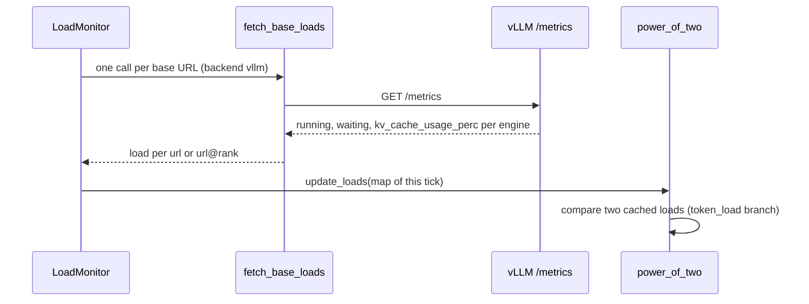
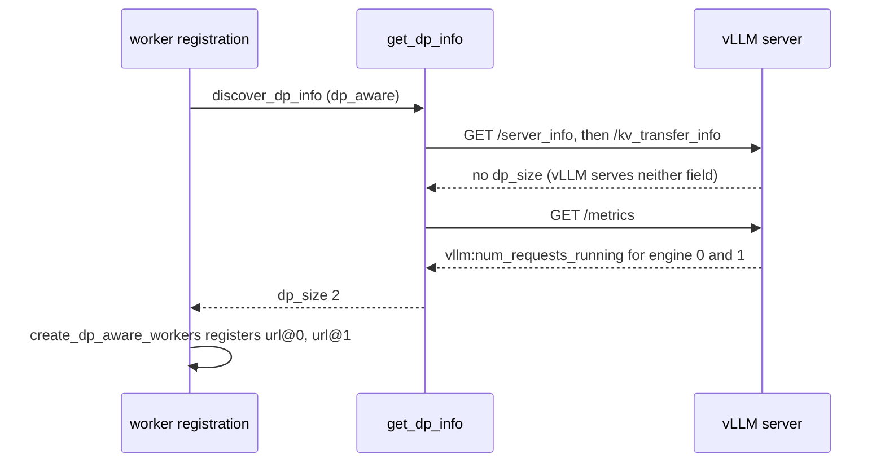
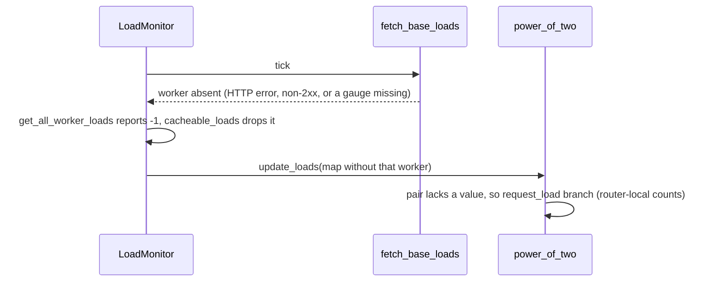
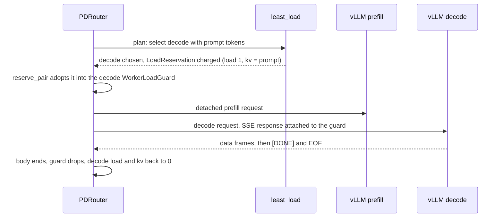

# Load signals for native vLLM workers

With `--backend vllm`, the LoadMonitor reads each vLLM worker's `/metrics` so
`power_of_two` compares real engine load, and decode `least_load` is proven on
the vLLM P/D path, streaming included. Requirement and acceptance (A1-A3):
[#23](https://github.com/MengqingCao/ATOM/issues/23). Principles in force: the
agent-team defaults plus [principles.md](principles.md).

vLLM references below are pinned to vLLM `main` at
[`eb42ba633`](https://github.com/vllm-project/vllm/tree/eb42ba633eec9453f161e33494ae49d0284b12f2).

## Scenarios

### S1. `power_of_two` on vLLM workers (Goal 1, A1)

Every tick, `LoadMonitor::monitor_loop` calls
`WorkerManager::get_all_worker_loads`, which groups HTTP workers by base URL
and calls `fetch_base_loads` once per instance. The vLLM branch reads
`/metrics`, takes one load per worker, and the rest of the path is the one ATOM
workers already use.



A DP server with `--data-parallel-size 2`, added with `--dp-aware`, is
registered as `http://h:8000@0` and `http://h:8000@1`. vLLM serves no
`dp_size`, so registration reads it from the same `/metrics` (D12):



Then each tick the body holds

```text
vllm:num_requests_running{engine="0",model_name="m"} 3.0
vllm:num_requests_waiting{engine="0",model_name="m"} 1.0
vllm:kv_cache_usage_perc{engine="0",model_name="m"} 0.42
vllm:num_requests_running{engine="1",model_name="m"} 2.0
...
```

so `@0` gets `1000 * (3 + 1) + 420 = 4420`, and `@1` its own engine's value.

### S2. A failed read (Goal 1, A1)



`update_loads` replaces the whole cache, so the last good value of the failed
worker is gone: nothing is written for it, and no stale value survives.

### S3. Decode `least_load` on vLLM P/D, streaming (Goal 2, A2)



The path is `PDRouter::dispatch_pd` -> `plan_pd_pair` -> the planner ->
`atom/mesh/src/core/placement/policy_apply.rs: apply_policy` (takes the
reservation) -> `reserve_pair` (`WorkerLoadGuard::adopt`) -> `execute_reserved`
(`VllmAdapter` fields, `dispatch_vllm_mooncake_internal`,
`AttachedBody::wrap_response`), all in `atom/mesh/src/routers/http_pd_router.rs`.

## Decisions

**D1. One load path.** `fetch_base_loads` gains a `BackendType::Vllm` branch
beside the ATOM one, reusing `get_text`, `samples` and `label_value`.
`get_all_worker_loads`, `cacheable_loads` and `monitor_loop` stay unchanged.
Basis: principle *One load path for every backend* ([principles.md](principles.md));
code `atom/mesh/src/core/worker_manager.rs: fetch_base_loads` already branches
per backend. Rejected: a separate vLLM poller feeding `power_of_two`, a second
path the principle forbids.

**D2. `/metrics`, three gauges.** `vllm:num_requests_running`,
`vllm:num_requests_waiting`, `vllm:kv_cache_usage_perc` (a 0-1 fraction despite
the name). Basis: requirement Goal 1; reference
[`loggers.py: PrometheusStatLogger`](https://github.com/vllm-project/vllm/blob/eb42ba633eec9453f161e33494ae49d0284b12f2/vllm/v1/metrics/loggers.py)
registers each with labels `model_name`, `engine` and `multiprocess_mode="mostrecent"`,
so one sample per engine. Today the vLLM backend falls through to `/get_load`,
which vLLM does not serve, so every tick fails. Rejected: vLLM's `/load`
([`basic.py: get_server_load_metrics`](https://github.com/vllm-project/vllm/blob/eb42ba633eec9453f161e33494ae49d0284b12f2/vllm/entrypoints/serve/instrumentator/basic.py)),
one API-server counter with no per-engine split, off unless
`--enable-server-load-tracking`.

**D3. One number per worker:
`load = 1000 * (running + waiting) + min(999, floor(1000 * kv_cache_usage_perc))`.**
Requests decide first, as ATOM's load does (`parse_queued_requests`); the KV
per-mille only breaks a tie between equal request counts, so the scale has no
tuning knob. Basis: code `atom/mesh/src/policies/power_of_two.rs: PowerOfTwoPolicy`
compares two cached `isize` values, and widening the cache type would touch
every policy's `update_loads`. `/get_loads` shows this number for vLLM workers;
its unit is already backend-specific (tokens for SGLang, requests for ATOM).
Rejected: `running + waiting` alone, which reads the KV gauge Goal 1 and A1 name
for nothing. Confidence low (see Low confidence).

**D4. `engine` label to `url@rank`.** A DP-aware worker (`Worker::dp_rank` is
`Some(k)`) reads the samples whose `engine` label is `"k"`. A worker without a
rank reads every engine in the body: requests summed, KV averaged (D5). Basis:
reference [`core_client.py`](https://github.com/vllm-project/vllm/blob/eb42ba633eec9453f161e33494ae49d0284b12f2/vllm/v1/engine/core_client.py)
sets `engine_ranks_managed` to global DP ranks, which become the `engine` label;
code `create_worker.rs` registers `url@0..dp_size` (for vLLM, `dp_size` from D12), and the ATOM branch of
`fetch_base_loads` maps `dp_rank` the same way. Rejected: the instance total for
every rank, which the `/get_load` branch's own comment rejects as a per-rank
load.

**D5. KV of a rankless multi-engine worker is the mean.** One server's engines
share one cache config, so the mean is the instance's occupancy, and it stays
in 0-1 so D3's scale holds. Rejected: the max, since the fullest engine
preempts first; about as strong. Confidence low.

**D6. A missing gauge is a failed read.** A worker gets a load only when all
three gauges exist for each engine it reads. Basis: every vLLM v1 server
registers all three per engine (D2); vLLM v0 had `gpu_cache_usage_perc` and no
`engine` label, so it falls back rather than compare partial data. Rejected:
ATOM's rule (`parse_queued_requests`: waiting defaults to 0), which compares a
defaulted gauge with a real one.

**D7. A failed read adds no code.** S2 is today's path: absent becomes `-1`,
`cacheable_loads` drops it, `monitor_loop` publishes the tick's map, and
`power_of_two` takes `request_load`. Basis: code `worker_manager.rs:
get_all_worker_loads, cacheable_loads, LoadMonitor::monitor_loop`;
`power_of_two.rs: select_with_decision`; principle *One load path for every
backend*. Rejected: keeping the last good value for some ticks; a stale load is
worse than none.

**D8. `least_load` keeps its own accounting.** It does not read the sampled
gauges. Basis: Goal 2 asks that ROCm/ATOM#3567's policy works on vLLM, not for
a new signal; principle *No generality for speculative needs*. Rejected:
blending engine gauges into `least_load`, which nobody asked for, and a sampled
value lags the reservation it would blur.

**D9. A1 tests sit in `atom/mesh/tests/routing/vllm_load_tests.rs`,** included
from `worker_manager.rs` with `#[cfg(test)] #[path]` as module
`vllm_load_tests`, so `GATE_TEST_FILTER=vllm` selects them by module path.
Basis: overlay `new_tests_dir`; `http_pd_router.rs` includes
`tests/routing/http_pd_load_tests.rs` the same way; the parsers are
`pub(crate)`, out of an integration test's reach. Rejected: the inline tests
module of `worker_manager.rs`, against `new_tests_dir`.

They are:

- parse: a two-engine body with `model_name` labels, a
  `vllm:num_requests_waiting_by_reason` line and an unrelated metric yields
  each engine's three values (the `_by_reason` line is not read as `waiting`);
- engine split: `get_all_worker_loads(.., BackendType::Vllm)` over `@0`, `@1`
  of one metrics server and a rankless worker on a one-engine server gives each
  its D3 load;
- DP discovery (D12): `get_dp_info` against a server that serves only
  `/metrics` returns `dp_size` 2 for engines `0` and `1`, and an error for
  engines `2` and `3`;
- failed-read fallback: a `PowerOfTwoPolicy` holding a stale value for a worker
  whose server is down, after one `get_all_worker_loads` ->
  `cacheable_loads` -> `update_loads` round, selects on router-local counts
  (`RouteDecision` branch `request_load`); a body missing one gauge gives that
  worker `-1` as well.

**D10. The A2 test drives `dispatch_pd`.** In
`atom/mesh/tests/routing/http_pd_load_tests.rs` (already a lib test module of
`http_pd_router.rs`), a test named `vllm_least_load_...` builds
`create_test_pd_router()` with `backend = BackendType::Vllm`, a `VllmAdapter`
over a hand-built `VllmPrefillInfo`, and `LeastLoadPolicy` as decode policy,
registers a `GatedServer` prefill and two decodes (one pre-charged so
`least_load` must pick the other), and dispatches a streaming chat with `tokens` set on the request context
(without them the decode charge is `DecodeCharge::Untokenized`, which holds no
KV).
It checks: the chosen decode holds load 1 and `decode_kv_tokens` equal to the
prompt length while it is still blocked (charged at selection, before any
decode response); the other decode is untouched; the charge holds after the
first SSE frame; and load and KV return to 0 once `[DONE]` and EOF end the
body. Basis: S3's path is everything past ingress, and ingress tokenization
does not depend on the backend (`atom/mesh/src/routers/ingress.rs:
requirements`). Rejected: `route_inference` through `PDRouter::new`, which needs
a mock bootstrap `/query` and a tokenizer and exercises no more of
`least_load`; and the `dispatch_with_policy` harness, which hand-builds the
plan so `least_load` never selects.

**D11. A2 needs no code unless its test fails.** `reserve_pair` adopts the
reservation for every backend, and `execute_reserved` attaches the pair to the
response body. If the test goes red, the fix belongs to the same task (Goal 2).

**D12. vLLM `dp_size` comes from `/metrics`.** `discover_dp.rs: get_dp_info`
gains a last fallback after `/server_info` and ATOM's `/kv_transfer_info`: GET
`/metrics`, collect the `engine` labels of `vllm:num_requests_running` with
D2's parser, and return their count as `dp_size` when they are exactly
`0..n`; any other set (none, or not starting at 0) is an error, so
registration fails as it does today rather than create ranks that never find
a sample. ATOM and SGLang answer an earlier step, so their path is unchanged.
Basis: requirement Goal 1 asks for the `url@rank` split on a vLLM DP worker,
which `create_worker.rs: create_dp_aware_workers` only builds from a
`dp_size`; reference
[`utils.py: create_metric_per_engine`](https://github.com/vllm-project/vllm/blob/eb42ba633eec9453f161e33494ae49d0284b12f2/vllm/v1/metrics/utils.py)
creates every managed engine's labeled gauge when the logger starts, so the
labels are listed before the first request; vLLM's `/server_info` is dev-mode
only and has no `dp_size`
([`api_router.py`](https://github.com/vllm-project/vllm/blob/eb42ba633eec9453f161e33494ae49d0284b12f2/vllm/entrypoints/serve/dev/server_info/api_router.py)).
Rejected: a `dp_size` the operator passes when adding the worker, a new
option that can disagree with the server, when the server already lists its
engines.

## Simpler alternative

Load = `running + waiting`, the KV gauge not read. It is the ATOM rule copied
and drops D3's scale and D5. It fails Goal 1 and A1, which name
`vllm:kv_cache_usage_perc` among the sampled metrics; reading it only to discard
it would be dead code.

## Low confidence

- **D3, the load formula.** The rival orderings (requests only; a weighted sum
  where a full cache counts as N requests) differ only in measured routing
  quality. The measurement that would settle it is the GPU comparison against
  `dp_sticky` on LLM-Booster#709, which #23 lists as a non-goal to be measured
  later, so no spike is opened. The tie-break form keeps the request ordering
  ATOM already uses, so it is the smallest step from known behaviour.
- **D5, KV mean for a rankless multi-engine worker.** Same measurement; it only
  matters for a DP server registered without `--dp-aware`, and only on ties.

## Dependencies

None: no spike, and no sync. `git log fork/mesh-vllm-load..origin/main` over
`worker_manager.rs` and `policies/` is empty, and ROCm/ATOM `main` has no
`vllm:num_requests` reader.

## Summary

**Deliverable.** `power_of_two` compares vLLM engine load per `url@rank`, falls
back to router-local counts on a failed read, and decode `least_load` is
proven to charge at selection and release at stream end on vLLM P/D.

**Scope.** The LoadMonitor's vLLM branch, vLLM `dp_size` discovery for
`--dp-aware` registration, their tests, and one `least_load` vLLM
P/D test (plus any defect it finds).

**Non-goals.** gRPC workers (they stay at `-1`); vLLM hybrid or external DP load
balancing where a server's `engine` labels do not start at 0 (`--dp-aware`
registration fails, D12; added without it, the server reads as one worker, D4); feeding the gauges to `least_load`; the GPU
comparison.

**Change per file.**

| File | Change |
|---|---|
| `atom/mesh/src/core/worker_manager.rs` | `fetch_base_loads` vLLM branch (D1, D4-D6) and a `pub(crate)` parser for the three gauges per engine (D2, D3); `#[path]` include of the tests |
| `atom/mesh/tests/routing/vllm_load_tests.rs` (new) | A1 tests (D9) |
| `atom/mesh/src/core/steps/worker/local/discover_dp.rs` | `get_dp_info` `/metrics` fallback (D12) |
| `atom/mesh/README.md` | `power_of_two` row: where it reads load per backend |
| `atom/mesh/tests/routing/http_pd_load_tests.rs` | the A2 test (D10) |

**Tasks.** Two, independent, both based on `mesh-vllm-load`:

1. *vLLM load read*: the first four rows. Code about 75 lines, tests about
   160. Done when A1 holds and the full gate passes (A3).
2. *`least_load` on vLLM P/D*: the last row, plus any defect fix in
   `http_pd_router.rs` or `worker.rs`. Code 0 unless the test finds a defect,
   tests about 80. Done when A2 holds and the full gate passes (A3).

**Acceptance.** A1 by task 1, A2 by task 2, A3 by each; checks as written in
#23. Note that the full gate only compiles integration tests; A1 and A2 tests
run under `GATE_TEST_FILTER=vllm`, which runs matching lib and integration
tests.
