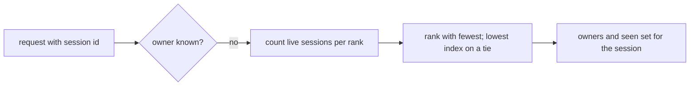
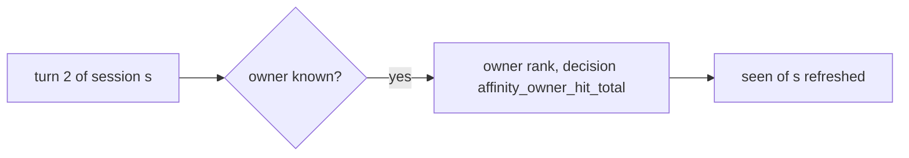
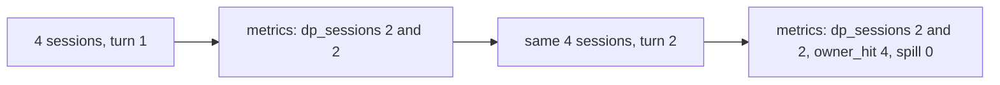

# Least-session placement for DP session affinity

Design for the `least-session-routing` line (MengqingCao/ATOM#85, from
wuhuikx/LLM-Booster#653). With DP session affinity on and the new switch set,
a new session goes to the DP rank holding the fewest live sessions instead of
the least-loaded rank. Everything else in DP routing stays as described in
[DP request load balancing](distributed_guide.md#dp-request-load-balancing).

## Principles

Defaults: the agent-team default principles apply unchanged. Project layer,
for this line:

1. **Function first.** This line delivers the placement policy and proves it
   works; no benchmark or performance claim is made or required. Why: the
   owner deferred performance to a later phase (#85).
2. **Opt-in, default unchanged.** With the new switch unset, DP routing
   behaves exactly as before. Why: upstream and other lines rely on the
   current load-based placement, and nothing yet shows which is better (#85
   Goals).

Defaults overridden: none.

## Settings

| Env | Type | Default | Meaning |
|---|---|---|---|
| `ATOM_DP_LEAST_SESSIONS` | bool (`_flag_env`) | off | Place each new session on the rank with the fewest live sessions; a full tie goes to rank 0. Takes effect only with `ATOM_DP_SESSION_AFFINITY=1`. |
| `ATOM_DP_SESSION_IDLE_S` | float seconds (`_positive_float_env`) | `7200` (120 minutes) | A session counts as live while its last request was routed at most this long ago. Read only when least-sessions is on. |

How they combine:

- `ATOM_DP_SESSION_AFFINITY=0`: `ATOM_DP_LEAST_SESSIONS` has no effect;
  CoreManager logs one warning at construction.
- `--dp-load-balance prefix_spread` or `share_cache` with affinity still
  fails at startup (`CoreManager._build_prefix_router`).
- `--dp-load-balance round_robin | least_requests | least_tokens` still places
  requests without a session id. Least-sessions replaces only the new-session
  choice that `CoreManager._select_new_session_rank_locked` makes today.
- An explicit `data_parallel_rank` hint still sets the session's owner.
- The pool-sharing spill (`SessionPolicy._relieve`, enabled by a connector's
  `session_migrate_margin`) is off under least-sessions: an established
  session never moves.

## Scenarios

**S1. New session (A1: fewest live, full tie to rank 0).**

On DP=2 with rank 0 holding 3 live sessions and rank 1 holding 1, the new
session goes to rank 1. With 2 and 2, it goes to rank 0.

**S2. Burst of new sessions (A1: spreads).** `CoreManager.add_request` routes
every seq of a batch inside one `_lb_lock` hold, and `SessionPolicy.select`
records the owner and the refresh time before it returns, so the next
placement already counts the previous one. Four new sessions on DP=2 land on
0, 1, 0, 1.

**S3. Later turn (A1: stays on owner).**

**S4. Idle session (A1: stops counting, next turn still goes to owner).**
Session `s` on rank 1 receives no request for longer than
`ATOM_DP_SESSION_IDLE_S`. The live-count scan skips it, so new sessions see
rank 1 one lighter. Its `owners` entry is kept; its next turn takes S3's path,
lands on rank 1 and is live again.

**S5. Switch unset (A2).** `_dp_session_idle_s` is `None`, `SessionPolicy` is
built exactly as today, and `get_dp_router_statistics` counts owners as today.
The existing DP routing tests pass unedited.

**S6. Live DP=2 server (A4).**

An owner hit with no spill and no explicit hint is routed to the owner the
first turn set, so the counters show every second turn on its first turn's
rank. Prometheus exposes the counters with a `_total` suffix
(`atom:dp_affinity_owner_hit_total`).

## Decisions

Each decision with its basis and the strongest rejected alternative.

1. **Switch is a bool env, `ATOM_DP_LEAST_SESSIONS`.** Basis: code:
   `CoreManager._get_dp_policy` -- `--dp-load-balance` still places
   sessionless requests while affinity is on, and session behaviour is
   already an env (`ATOM_DP_SESSION_AFFINITY` in `atom/utils/envs.py`);
   principle: change public interfaces only when the requirement does.
   Rejected: a `--dp-load-balance least_sessions` choice, which would have to
   say how sessionless requests are placed and widens a validated CLI list.
2. **Idle window in seconds, `ATOM_DP_SESSION_IDLE_S`, default 7200.** Basis:
   code: every duration env in `atom/utils/envs.py` is seconds with an `_S`
   suffix and `_positive_float_env` exists; #85 Goal 2 fixes 120 minutes.
   Rejected: a minute-valued env, the only one of its kind.
3. **Switch without affinity is inert and warns.** Basis: code:
   `CoreManager.__init__` warns for `ATOM_DP_DISPATCH_DEPTH` under a policy
   that ignores it. Rejected: fail at startup, which the codebase reserves for
   two policies that conflict (`_build_prefix_router`).
4. **No spill under least-sessions.** Basis: #85 Goal 1 and A1 (later turns
   stay on their rank); code: `SessionPolicy._relieve` moves the owner when
   `rank_reqs` is given. Rejected: keep spill when a connector sets a margin,
   which breaks Goal 1 on those deployments.
5. **Live counts are derived, not stored.** `SessionPolicy` keeps
   `seen: dict[session, float]`; a rank's live count is one scan of `owners`
   counting sessions with `now - seen <= idle_s` and an in-range owner.
   Basis: reference: the mesh router's
   `DpStickyPolicy::select_new_session_worker`
   (`atom/mesh/src/policies/dp_sticky.rs`) counts the same way; principle:
   the simplest solution that meets acceptance -- a derived count cannot
   drift from `owners`, which hints and `reset_dp_router` also change. The
   scan is O(sessions) per new session and per metrics scrape, under
   `_lb_lock`; Function first defers that cost. Rejected: an LRU
   `OrderedDict` with per-rank counters, O(1) amortised but a second state
   every owner change must keep in step.
6. **Every routed request with the session id refreshes it**, at routing
   time, in every branch of `SessionPolicy.select` (new, owner hit, explicit
   hint). Basis: #85 Goal 2 ("its last request"); reference: `dp_sticky.rs`
   sets `last_access` on routing. Rejected: refresh on completion, which needs
   a seq-to-session map in the release hook for a difference of one request's
   run time against a two-hour window.
7. **Idle means `now - seen > idle_s` on `time.monotonic`; the binding is
   kept.** Basis: #85 Goal 2 and Non-goals; reference: `dp_sticky.rs` treats
   `<=` as live. Rejected: `time.time`, which jumps with clock changes.
8. **Ties go to the lowest rank index**, with no load tie-break:
   `min(range(rank_count), key=lambda r: (live[r], r))`. Basis: #85 Goal 1
   fixes a full tie to rank 0, and the lowest index is the one rule that also
   gives that; reference: wuhuikx/LLM-Booster#653 states the rule as count
   only. Rejected: a load tie-break as in `dp_sticky.rs`, which moves a full
   tie off a loaded rank 0.
9. **State placement.** `seen` lives in `SessionPolicy` and
   `SessionPolicy.reset` clears it. CoreManager gains one attribute,
   `_dp_session_idle_s` (`None` = off), with a class-level default of `None`
   and set in `__init__` from the two envs; `_get_dp_policy` passes it as
   `SessionPolicy(..., idle_s=...)`. Basis: code:
   `tests/test_dp_load_balance.py: _make_mgr` builds CoreManager by
   `__new__`, so a new attribute without a class default raises there, and
   `CoreManager._session_migrate_margin = None` is the existing pattern.
   Rejected: `seen` on CoreManager beside `_dp_session_owners`, which needs a
   mutable class default or `getattr` fallbacks for a dict only the policy
   reads.
10. **`atom:dp_sessions`**: off (default, and plain affinity), sessions owned
    per rank, as today; least-sessions on, live sessions per rank, the count
    placement uses (`SessionPolicy.live_counts()`).
    `CoreManager.get_dp_router_statistics` fills `session_count_per_rank`
    from one or the other. Basis: A4 reads this gauge; principle: change
    public interfaces only when the requirement does. Rejected: a second
    gauge for live sessions, a public metric nothing asks for.
11. **Tests age sessions by monkeypatching
    `atom.model_engine.dp_routing.policies.time.monotonic`**, and drive
    `CoreManager._select_dp_rank_for_seq_locked` and `_charge_seq_load_locked`
    on a bare CoreManager as `tests/test_dp_load_balance.py: _make_mgr, _route`
    do. Basis: A1 requires CoreManager's real routing code. Rejected: an
    injectable clock argument used only by tests.

## Simpler alternative

Count every owned session (`owners` only, no `seen`, no window): the count
`get_dp_router_statistics` already produces. It fails #85 Goal 2 and the A1
idle case: a session idle past the window would keep counting for its rank.

## Low confidence

None.

## Dependencies

No spike or sync issue. The mesh router's `dp_sticky.rs` is read as a
reference only; nothing is taken from ROCm/ATOM.

## Summary

- **Deliverable:** opt-in least-session placement of new DP sessions under
  `ATOM_DP_SESSION_AFFINITY=1`, its two settings, docs, unit tests and a live
  DP=2 smoke script.
- **Scope:** new-session placement and the per-rank session gauge.
- **Non-goals:** performance; dropping idle bindings; sessionless routing;
  new `--dp-load-balance` choices; the mesh Rust router; upstreaming.

Change per file:

| File | Change |
|---|---|
| `atom/utils/envs.py` | `ATOM_DP_LEAST_SESSIONS`, `ATOM_DP_SESSION_IDLE_S` |
| `atom/model_engine/dp_routing/policies.py` | `SessionPolicy`: `idle_s` argument, `seen`, least-live new-session branch, refresh in `select`, `live_counts()`, `reset` clears `seen` |
| `atom/model_engine/engine_core_mgr.py` | `CoreManager._dp_session_idle_s` (class default `None`, set in `__init__`), the inert-switch warning, `_get_dp_policy` wiring with spill off, `get_dp_router_statistics` live counts |
| `atom/metrics/exporter.py` | help text of `atom:dp_sessions` and `atom:dp_affinity_new` |
| `docs/environment_variables.md`, `docs/distributed_guide.md`, `docs/metrics_guide.md` | the two settings and the gauge's meaning |
| `tests/test_dp_session_least_sessions.py` (new) | A1's five cases |
| `.claude/agent-team/smoke_least_sessions.sh` (new) | A4 |

Tasks:

| Task | File set | Acceptance | Depends on |
|---|---|---|---|
| T1. Least-session policy | envs.py, policies.py, engine_core_mgr.py, exporter.py, the three docs, `tests/test_dp_session_least_sessions.py` | #85 A1, A2, A3 | this design |
| T2. Live DP=2 smoke | `.claude/agent-team/smoke_least_sessions.sh`; run under a 2-GPU gpool lease on one pit2-p03 node | #85 A4 (S6) | T1 |
