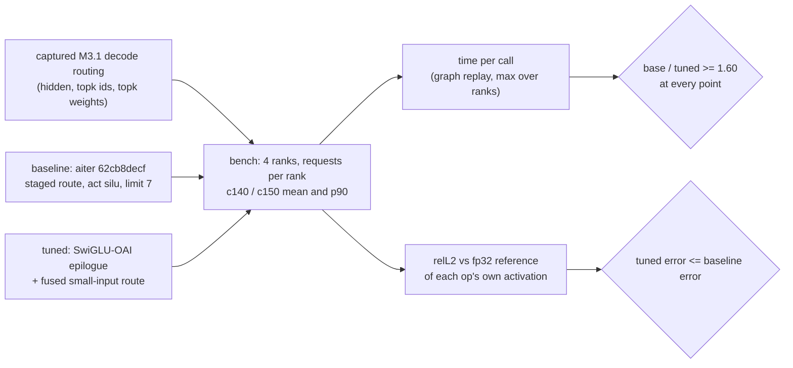
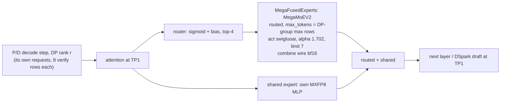
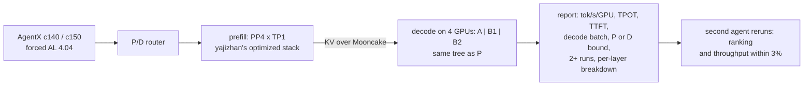

# MiniMax-M3.1 P/D decode: MegaMoE tuning and DEP4 integration

Requirement: MengqingCao/ATOM#14. This document plans how to meet it: the
MegaMoE operator work, its integration into ATOM's DEP4 decode, and the 1P1D
benchmark that gives the verdict. The binding rules (numerics, P/D only,
gpu-pool, where kernel PRs go) are the overlay's
(`.claude/agent-team.md` on `mengqing/m31-decode-dep4`); this document cites
them and does not restate them.

Arms, as the requirement names them:

- **A**: `-tp 4` with `ATOM_M3_INDEXER_CP=1` (decode today).
- **B1**: DEP4, `-tp 4 --enable-dp-attention --enable-expert-parallel` (MoRI
  dispatch / combine + fused_moe experts).
- **B2**: B1 plus `--moe-backend mega` with the tuned operator.

## Scenarios

### S1. The operator meets A1

The tuned MegaMoEV2 runs the EP4 experts step at the c140 and c150 decode
points with captured M3.1 routing, and beats the baseline op by 1.6x at each
point without losing accuracy.

### S2. B2 decodes M3.1 at A's numerics (A2)

The same path without `--moe-backend mega` is B1: MoRI dispatch / combine
around fused_moe.

### S3. The verdict (A3)

## The decode points

The per-rank token count the operator sees is the rows its own DP rank sends:
8 DSpark verify rows per decoding request. The decode batch at c140 and c150
comes from the prior 1P1D telemetry
(`/share_nfs/yajizhan/tmp/m31-decode/cost-model/eng_c140-*.csv`,
`eng_c150-*.csv`): mean 50.4 and 52.2 requests, p90 72.8 and 69.0. Under
`least_requests` DP routing the largest rank holds about B/4 + 0.7..0.9
requests (`cost-model/dp/x1.least_requests.summary.json`). That gives:

| point | requests per rank | rows on the largest rank |
|---|---|---|
| c140_mean | 13, 13, 12, 12 | 104 |
| c150_mean | 13, 13, 13, 13 | 104 |
| c140_p90 | 19, 18, 18, 18 | 152 |
| c150_p90 | 18, 17, 17, 17 | 144 |

Those runs were NVFP4 on an older stack, so the points can move on the target
stack. The benchmark also sweeps 4..40 requests per rank so the table brackets
wherever they land; T3's first B1 / B2 run reports the real decode batch, and
A1's final check reruns at those points.

## Operator baseline and microbenchmark

**Baseline**: ROCm/aiter `62cb8decf`, the last first-parent `main` commit
before #14 was opened. The image `rocm/atom-dev:nightly_202611240650` ships
aiter `82b6b4f19`, whose `aiter/ops/flydsl/` is identical to `62cb8decf`, so
it measures the baseline op.

aiter main has no SwiGLU-OAI MegaMoE epilogue
(`mega_moe/gemm_util.py` accepts act `silu` and `situv2`; ATOM's
`MegaFusedExperts.__call__` refuses `ActivationType.Swiglu`). The baseline
therefore runs `act="silu", swiglu_limit=7.0`, the closest activation it has.
The epilogue is elementwise on the GEMM1 accumulator, so this keeps the
baseline's data movement and GEMM work; the tuned op carries the heavier
SwiGLU-OAI epilogue, which only makes the 1.6x test stricter. Each op's error
is measured against the fp32 reference of its own activation.

The baseline instance is the one `atom/model_ops/fused_moe/flydsl_mega_experts.py:
_get_mega` builds: `MegaMoEV2(quant="a8w4", max_tok_per_rank=512,
swiglu_limit=7.0)`, called without `max_tokens`, which takes the staged
compact route. MTPR 512 stays in the bounded config class, whose combine wire
is `none`, bf16 (`mega_moe_config._select_bucket_config`,
`P2P_FP8_MIN_MTPR`).

**Routing**: captured from an M3.1 arm-A decode window (TP4, eager, DSpark
k=7, forced AL 4.04, AgentX-built prompts from the prior harness'
`fast_loop.py --prompt agentx`, 56 requests). A scratch `sitecustomize.py`
wraps `FusedMoE.forward_impl` and `FusedMoE.select_experts` and saves, per
decode MoE call, the topk ids and weights, and the MoE input hidden states of
layers 3, 20, 40 and 59. A point takes distinct captured requests for each
rank, so the cross-rank routing is real. Weights are random MXFP4: the op is
weight-streaming bound and its time does not depend on their values.

**Benchmark**: `bench_m31_megamoe.py` under
`/share_nfs/mengqing/code/tmp/m31-decode-dep4/15/bench/` (data in `runs/`),
run with `torchrun --nproc-per-node 4` from aiter's
`op_tests/multigpu_tests` (it reuses `test_mega_moe_v2.py`'s setup, weights,
fp32 reference and graph-replay timer). Time is the median of 15 replays of a
50-call CUDA graph, max over ranks. T1 moves it into its aiter PR as the A1
command.

### Baseline table

aiter 62cb8decf (image aiter 82b6b4f19), MI355X g52, 4 GPUs, layer 20 unless
noted, staged route:

| point | rows / rank (largest) | time (us) | relL2 vs fp32 |
|---|---|---|---|
| u4 | 32 | 219.7 | 0.0470 |
| u8 | 64 | 246.3 | 0.0470 |
| u12 | 96 | 282.0 | 0.0470 |
| c140_mean | 104 | 283.3 | 0.0470 |
| c150_mean | 104 | 283.6 | 0.0470 |
| u16 | 128 | 292.0 | 0.0470 |
| c150_p90 | 144 | 300.8 | 0.0470 |
| c140_p90 | 152 | 308.0 | 0.0470 |
| u24 | 192 | 339.5 | 0.0470 |
| u32 | 256 | 386.3 | 0.0470 |
| u40 | 320 | 435.9 | 0.0470 |

Other layers at the A1 points (us): layer 3 288.8 / 290.0 / 314.5 / 304.7,
layer 40 291.7 / 292.0 / 333.5 / 317.8, layer 59 293.3 / 293.3 / 328.8 /
315.6 (c140_mean / c150_mean / c140_p90 / c150_p90). Building the instance
with `routed=True` and passing `max_tokens` changes nothing (284-308 us): no
fused route exists for this layout.

## Lowering plan (e2e-optimization / amd-e2e-lowering)

**Work card**: gfx950 (MI355X, 8 XCDs); MiniMax-M3.1 decode, DEP4, EP4 over
one node (XGMI, peer symmetric heap); 128 experts, 32 per rank, top-4, hidden
6144, inter 3072, MXFP4 weights, a8w4; 104-152 rows per rank at the A1
points; numerics per the overlay; metric: op time at the A1 points, then
output tok/s per GPU in 1P1D.

**Attribution** (torch profiler, c140_p90, layer 20, per call):

| kernel | time (us) | share | what it moves |
|---|---|---|---|
| `megamoe_prepare_compact` | 52 | 17% | routing metadata, MXFP8 quant of the rank's rows |
| `megamoe_stage1_compact` | 143 | 46% | payload pull, GEMM1 (w1: 604 MB), SwiGLU, MXFP8 quant |
| `megamoe_stage2_compact` | 63 | 20% | GEMM2 (w2: 302 MB), rows written to the source ranks |
| `ep_combine_intranode` | 56 | 18% | top-4 weighted sum of bf16 rows |

At every A1 point all 32 local experts receive rows, so each rank streams
all its expert weights: about 960 MB per layer with E8M0 scales. GEMM work is
about 84 GFLOP per rank, about 17 us of MFMA time, so the op is
weight-streaming bound. Stage1 + stage2 stream at about 4.7 TB/s; prepare and
combine, 35% of the time, move no weights. EP imbalance is real (at layer 20
the busiest rank receives 1.6x the rows of the quietest), but every rank
streams its 32 experts either way, so it does not set the time.

**Boundaries** (graph: prepare -> stage1 -> stage2 -> combine):

| edge | class today | dependency | verdict |
|---|---|---|---|
| prepare -> stage1 | C4, K-rank | per-token route counters | fuse: the small-input route already expresses it as counters |
| stage1 -> stage2 | C4 (MXFP8 intermediate in HBM) | per-tile counter | fuse: GEMM2 of an expert starts when its GEMM1 tiles land |
| stage2 -> combine | C4, K-rank | per-token counter on the peer rows | fuse: `make_fused_combine_tail` is the same sum |
| MoE -> shared expert | separate MLP | none | keep: the overlay keeps the shared expert its own MXFP8 MLP |

**Candidates**, priced at c140_mean (283 us) and c140_p90 (308 us); target
177 us and 192 us:

| id | change | predicted time | predicted gain | basis |
|---|---|---|---|---|
| K1 | SwiGLU-OAI GEMM1 epilogue (`act.swiglu_mul_batch`: alpha 1.702, up + 1, clamps at 7), fp32 before the MXFP8 quant | +0..2 us | 1.00x | elementwise on accumulators; required for B2 to be correct |
| K2 | fused small-input route for the M3.1 EP4 layout: dispatch, GEMM1, K1's epilogue, GEMM2 and combine in the fused kernels | ~166 us at both points | 1.70x / 1.85x (1.5x if it keeps only V4.1's staged-to-fused ratio) | measured analog, below |
| K3 | tile / persist-CU / grid tuning of K2's kernels | to the ~145 us floor at 6.6 TB/s | up to 1.95x / 2.1x | only if K2 lands short |
| K3' | tune the staged route alone | ~266 / ~274 us | 1.06x / 1.12x | stage1 + stage2 at 5.8 TB/s; prepare + combine stay |

The analog: on the same node, aiter's own routes suite at the
DeepSeek-V4.1-Flash EP4 layout (`test_mega_moe_v2.py --suite routes --network
v41_flash --time-only --max-tok-per-rank 512`) times the fused small-input
route at 1.49x-1.57x the staged route for 32-256 rows per rank, and streams
about 5.8 TB/s (1.8 GB of weights in 311 us at 104 rows). At 5.8 TB/s the
M3.1 weight floor is about 166 us. M3.1's staged route already streams
faster than V4.1's (4.7 vs 3.7 TB/s), so the ratio alone understates K2; the
floor estimate overstates it if the port does not reach V4.1's bandwidth.

K2 is kernel work, not a table entry. Admitting the layout to
`FUSED_LAYOUTS` fails at build: `mega_moe_small_m._use_direct_fixed_slot`
accepts only 48, 96 or 192 experts per rank (EP8 / EP4 / EP2 DeepSeek), and
`mega_moe_config.fused_layout_supported` requires `swiglu_limit == 10.0` and
`act == "silu"`. The port generalizes the fixed-slot geometry to 32 experts
per rank and top-4, carries K1's activation, and admits
`(4, 6144, 3072, 128, 4)`.

**Gates** for T1: legality (the route plan's per-token and per-tile counters,
the existing epoch-wrap and zero-row checks of `test_mega_moe_v2.py --suite
routes`); correctness (relL2 against the fp32 SwiGLU-OAI reference no worse
than the baseline's against its own; graph capture); cross-rank visibility
(the route's existing uncached peer buffers, unchanged); fidelity (captured
routing, not synthetic); performance (A1 points, all four layers).

**Fallback**: a call the fused route cannot serve (rows above its capacity)
takes the staged route, as aiter's route plan does today; every rank takes
the same route because the choice reads only the DP-group max rows.

## ATOM integration gaps

Checked at `fork/mengqing/m31-decode-dep4` e60dd5d.
`git log fork/mengqing/m31-decode-dep4..origin/main` shows no upstream change
to these files, so none is a sync.

**B1 and B2**

- The M3.1 DSpark draft refuses fewer than 4 KV heads per rank
  (`atom/models/minimax_m3/dspark.py`, the "needs TP >= its KV head count"
  guard), so neither DEP4 arm starts. At TP1 each rank holds all 4 KV heads:
  expand each row's page table to one row per KV head (page16 * H + h), as the
  target's fused top-k already emits for `sparse_pa_per_row`. A CPU-tested
  patch exists in the prior material
  (`dep-code/patches/m31_dspark_tp1_draft.patch`); T2 rebuilds it on the
  integration branch and checks draft parity on a GPU.
- `ATOM_M3_INDEXER_CP=1` with `--enable-dp-attention` passes
  `atom/config.py: indexer_cp_unsupported_reason` and crashes in the first
  forward (attention at TP1 scores all index heads already). Refuse it at
  config time.
- Config only, in T3's launch scripts: pass Mooncake's `ib_device` (the auto
  pick in `mooncake_connector.py` `int()`s a `GPU-<uuid>` ROCR mask), and
  route a session's turns to one DP rank (`dp_sticky` with session ids), as
  CI's agentic DPA recipe does.

**B2 only**

- `MegaFusedExperts.__call__` refuses `ActivationType.Swiglu`: pass T1's
  SwiGLU-OAI activation with M3.1's `swiglu_alpha` and `swiglu_limit`, and key
  `_get_mega`'s cache on them.
- Build `MegaMoEV2(routed=True)` and pass `max_tokens` = the DP group's
  largest rank's rows (`DPMetadata`), so all ranks take the same route: the
  routing half of ROCm/ATOM#3187. M3.1 runs its shared expert inline in
  `atom/models/minimax_m3/model.py`, so #3187's single-stream gating is not
  needed.
- Pass `stage2_p2p_quant="none"`: the combine wire stays bf16 even when a
  larger `--max-num-batched-tokens` pushes MTPR to 1024.
- Launch: `--max-num-batched-tokens 512` per rank (MTPR is a power of two;
  64 requests per rank at k=7, the same as the DP + drafter graph cap
  `ATOM_TOKEN_GRAPH_DP_MAX_TOKENS`).

**Numerics** (overlay): MegaMoE quantizes activations to MXFP8 (a8w4,
`MegaMxfp4MoEMethod`). Arm A's fused_moe runs MXFP4 activations at 256 rows
and above (aiter `resolve_activation_dtype`, through
`Mxfp4MoEMethod.activation_dtype`), and A runs 400+ rows at the A1 points, so
B2 is no lower there. Below 32 decoding requests A runs bf16 and B2's MXFP8 is
lower: T3 reports the share of such steps per run.

## Decisions

| # | decision | basis | strongest rejected alternative |
|---|---|---|---|
| D1 | Baseline is aiter `62cb8decf`, measured with the image's identical `aiter/ops/flydsl/` | code: first-parent main before #14's creation; `git diff 82b6b4f19 62cb8decf -- aiter/ops/flydsl/` empty | the image's aiter as the named baseline: not "main at the umbrella's start" |
| D2 | The baseline runs clamped SiLU at limit 7; each op is checked against its own activation's fp32 reference | code: `gemm_util.py` act check; principle: overlay, "no worse versus fp32 than the code it replaces" | a requirement-gap ruling: the requirement fixes op, commit and shapes; only an activation aiter lacks is missing, and the closest one is the conservative timing |
| D3 | A1 points from prior telemetry, plus a 4-40 request sweep; A1 reruns at T3's measured points | reference: cost-model telemetry and DP replay | one fixed point each: tunes for a batch the target stack may not run |
| D4 | Real routing by capture from an arm-A decode window | code: `FusedMoE.forward_impl`, `FusedMoE.select_experts` | aiter's synthetic or Zipf routing: hides EP imbalance; the requirement asks for real routing |
| D5 | K1 then K2; K3 only if K2 is short of 1.6x; stop at 1.6x | measured attribution and analog above; principle: e2e-lowering, fuse edges whose dependency is a counter | K3' alone: leaves prepare + combine, at most 1.12x |
| D6 | ATOM passes `stage2_p2p_quant="none"` explicitly | code: `P2P_FP8_MIN_MTPR`; overlay bans an FP8 combine wire | relying on MNBT <= 512: one launch flag away from a banned wire |
| D7 | Port only the routing half of #3187 | code: no side stream in `minimax_m3/model.py` | the whole PR: its large-input route and side-stream gating serve DeepSeek layouts |
| D8 | Three tasks: operator, ATOM integration, 1P1D report | overlay `max_tasks` 3, `split_loc` 1000 | B1 enablement as its own task: a fourth task in the files B2 also edits |

## Simpler alternative

Integrate the baseline op with only K1 (the activation) and skip the fused
route. It needs no kernel port, but stays at about 1.0x and fails A1. Tuning
only the staged route (K3') reaches at most 1.06x-1.12x and fails A1 too.

## Low confidence

None. K2's gain is a prediction (1.5x-1.85x at the A1 points); T1 measures
it, and D5's order does not depend on it. If K2 plus K3 cannot reach 1.6x, T1
escalates with its measurements.

## Dependencies

No spike: the operator's gain can only be measured on the port itself, which
is T1. No sync issue: upstream has no change to the affected files.

## Summary

**Deliverable**: three tasks under #14.

- **T1 Operator** (MengqingCao/aiter PR, base `main`; the ATOM issue tracks
  it). K1 SwiGLU-OAI epilogue in `mega_moe/gemm_util.py` (and the fused
  route's GEMM1 store), exposed as a MegaMoEV2 `act` with alpha and limit; K2
  the fused small-input route for `(4, 6144, 3072, 128, 4)`
  (`mega_moe_small_m.py`, `mega_moe_config.py`); K3 only if needed;
  `op_tests/multigpu_tests/bench_mega_moe_m31.py` (this bench, taking the
  capture directory); a routes-suite network entry for M3.1. Named result:
  A1's table, baseline vs tuned at the A1 points, layers 3/20/40/59, with
  relL2. Estimate: about 500 lines of kernel and config, 250 of bench and
  tests.
- **T2 ATOM DEP4 integration** (PR on `mengqing/m31-decode-dep4`, depends on
  T1's interface). `atom/models/minimax_m3/dspark.py` (TP1 draft),
  `atom/config.py` (indexer CP refusal under DP attention),
  `atom/model_ops/fused_moe/flydsl_mega_experts.py` (activation, routed /
  `max_tokens`, bf16 wire), CPU tests in `tests/`. Named result: B1 and B2
  start at DEP4 with DSpark k=7 and give GSM8K-200 and acceptance length
  within A2's bounds of A, through P/D. Estimate: about 250 code, 200 tests.
- **T3 1P1D verdict** (depends on T1 and T2). Launch scripts and report under
  `/share_nfs/mengqing/code/tmp/m31-decode-dep4/<issue>/`, on the optimized
  prefill stack; A, B1, B2 at c140 and c150, 2+ runs per point, the metrics
  A3 lists, the per-layer breakdown of the top two arms, the decode batch per
  point, and the second agent's rerun. Named result: A3's report. Estimate: no
  tree code.

**Scope**: the decode instance on 4 GPUs in 1P1D; the operator on gfx950 at
EP4. **Non-goals**: the requirement's (aggregated serving, ATOMesh policy,
lossy numerics, writes to ROCm/ATOM, ROCm/aiter or LLM-Booster).

**Acceptance**: A1 by T1, A2 by T2, A3 by T3, each as the requirement states
its check.
