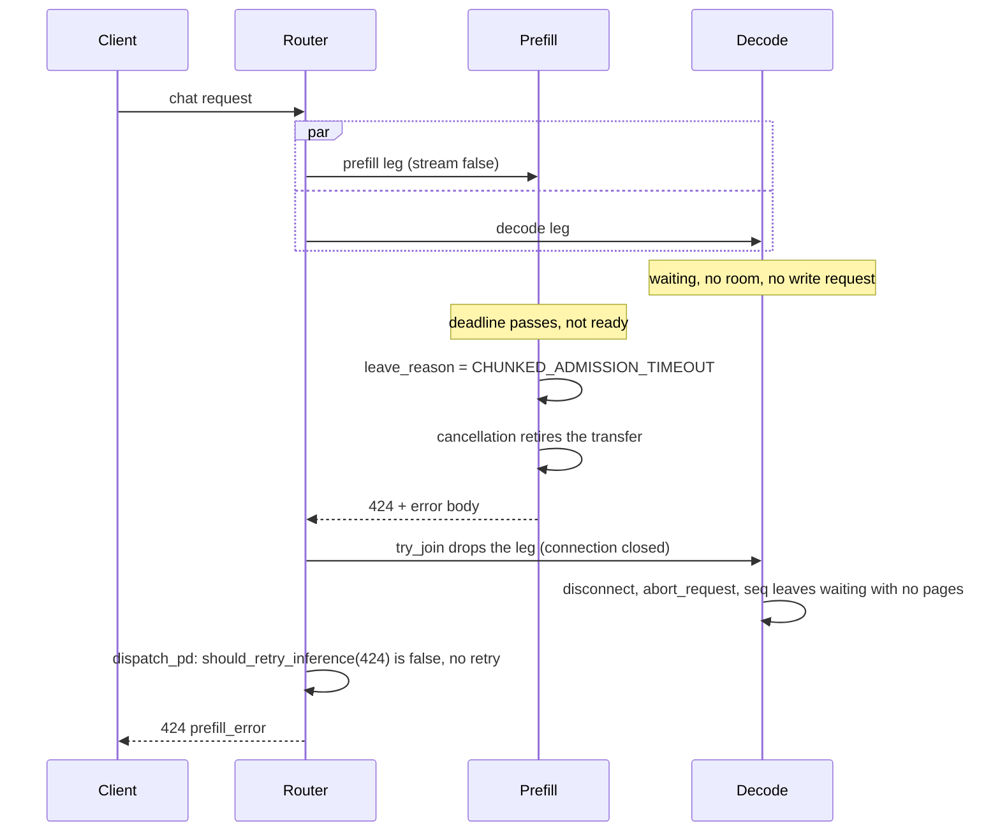
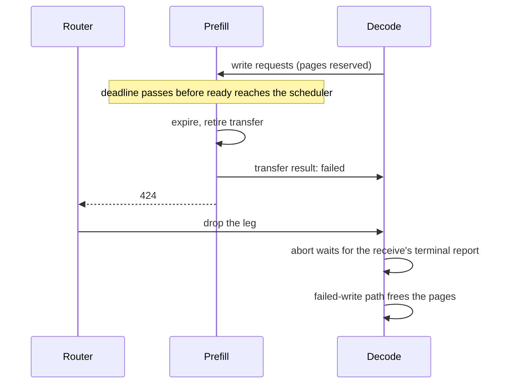
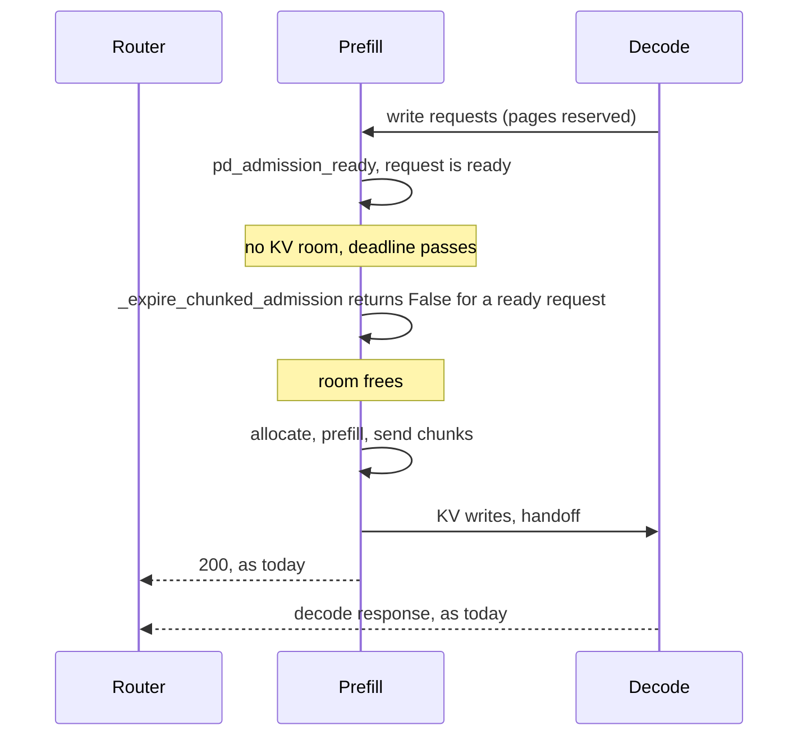
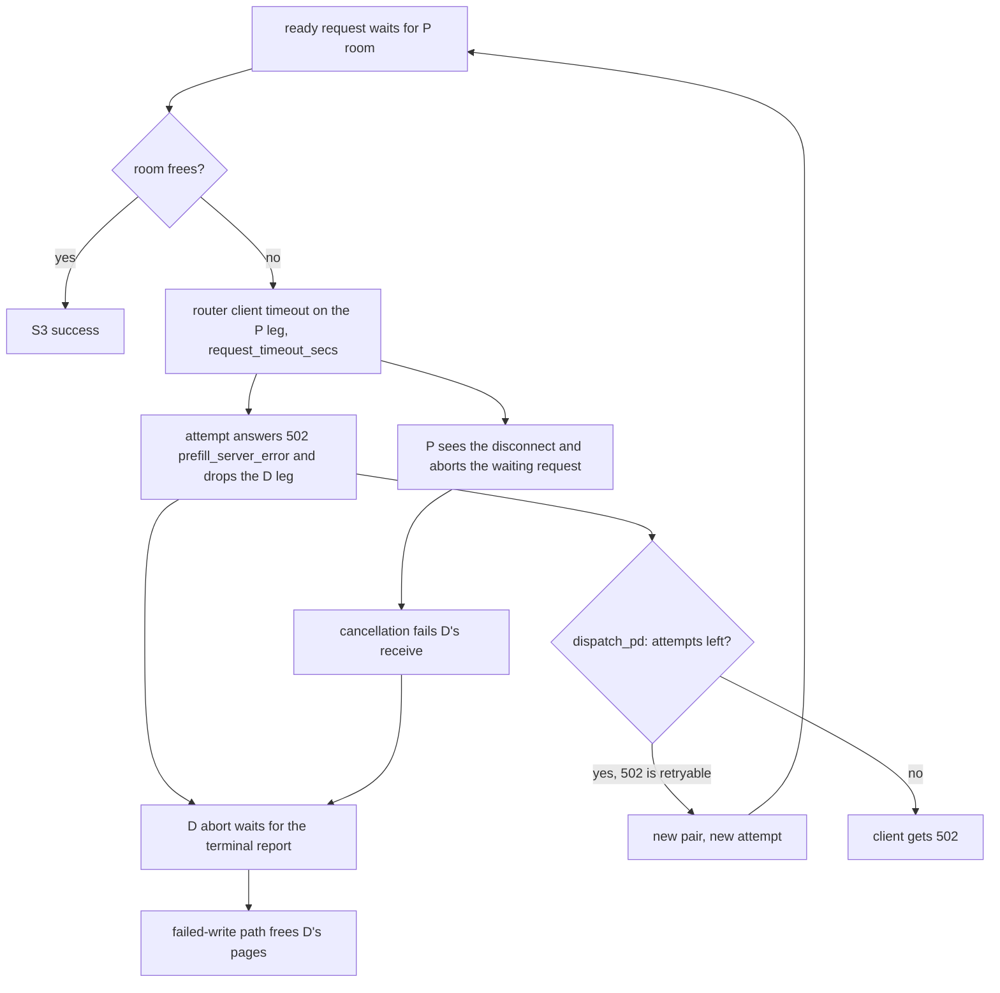
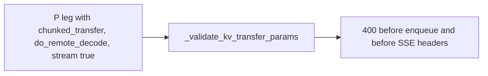
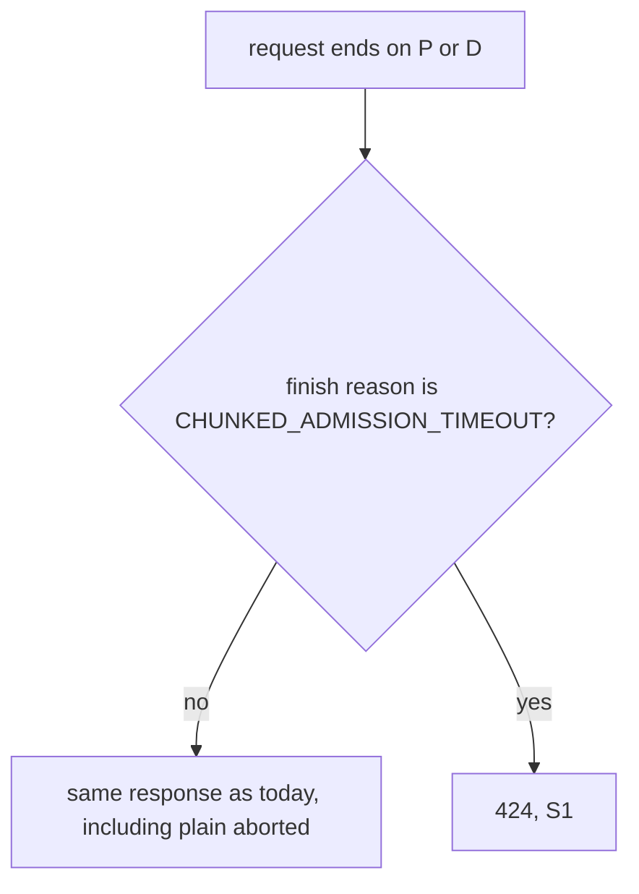

# Chunked P/D admission timeouts: end both sides at once

In chunked P/D, the router sends the prefill (P) and decode (D) legs of a
request at the same time (`atom/mesh/src/routers/http_pd_router.rs:
PDRouter::dispatch_atom_chunked_internal`). P holds the request until D has
reserved pages and posted its write request, and gives up after
`chunked_admission_timeout_s`. Today that give-up answers the client 200 with an
empty `aborted` finish, leaves D's leg running so D later reserves pages for a
request P has dropped, and also fires after D has already admitted the request.
This design ends a timeout with an error on both sides (wuhuikx/LLM-Booster#617
fix 3) and stops the clock once D has admitted the request (fix 4). Requirement:
MengqingCao/ATOM#93.

## Principles

The agent-team default principles apply unchanged. This line adds:

1. **Never reuse a page a producer may still write.** A decode page or budget
   is released only when no producer rank can still write into it; when
   unsure, hold it. Why: a late RDMA write into a reused page corrupts another
   request silently (wuhuikx/LLM-Booster#617, review of ROCm/ATOM#3536).
2. **A dropped request fails loudly.** A request the engine gives up on returns
   an error to its caller, never an empty success. Why: an empty 200 hid 1,114
   failures behind AgentX `errors=0` and kept the decode request alive
   (wuhuikx/LLM-Booster#617).
3. **Names match what the code does.** Rename a variable, function or file when
   its behaviour changes, and after a fix sweep the codebase for the same
   pattern. Why: ATOM `CLAUDE.md`, Critical Rules.

Defaults overridden: none.

## Terms

- **Ready**: P's scheduler has the aggregated `pd_admission_ready` success for
  the request (`MooncakeConnectorScheduler._chunked_ready`). P's workers send it
  once every D TP recipient of each P rank has posted its write request
  (`MooncakeConnector._report_chunked_admissions`), which D does only after
  reserving the request's pages. Ready is what "decode admitted" means here.
- **Admission timeout**: `MooncakeConnectorScheduler._expire_chunked_admission`
  aborting a waiting P request whose deadline (`chunked_admission_timeout_s`
  after registration in `admission_ready`) has passed.

## Scenarios

### S1. Unadmitted request times out (A1, A2)

D has no room, so the request is never ready. P expires it and answers 424,
the router drops D's leg before D admits it, and the client gets the 424 at
once: `should_retry_inference` does not retry it.

### S2. D admits just as P expires (A2, principle 1)

D reserved pages and posted write requests, but readiness had not reached P's
scheduler by the deadline. P still expires the request (S1), which retires
the transfer, so D's queued write requests fail.

Decode frees the pages only through its existing failed-receive path
(`MooncakeConnector._complete_recv` and the failed-write hold that
ROCm/ATOM#3536 reworks), so no producer can still write into them.

### S3. Ready request waits for P room past the deadline (A3)

An unready request beside it still expires as in S1.

### S4. Ready request never gets P room (bound)

Each attempt holds its D pages at most `request_timeout_secs` plus the
failed-write hold, and the client waits at most `max_retries` attempts
(decision 11). A client disconnect ends every leg at once, from D and F.

### S5. Streaming chunked prefill leg (Goal 1)

### S6. Everything else keeps its behaviour (A4, Goal 3)

Only `_expire_chunked_admission` sets the new reason, and only for a chunked
P request; non-chunked P/D and non-P/D serving never produce it.

## Decisions

1. **The timeout is a leave reason.** `_expire_chunked_admission` sets
   `seq.leave_reason = CHUNKED_ADMISSION_TIMEOUT`, a constant
   `"aborted: chunked P/D admission timed out"` in
   `atom/kv_transfer/disaggregation/types.py`. Basis: code:
   `atom/model_engine/engine_core_mgr.py: CoreManager._deliver_terminal_output`
   hands a rejected seq to the client as its `finish_reason`, the one field that
   already crosses the engine to API boundary. Rejected: a new flag on
   `Sequence` and `RequestOutput`, which needs plumbing through the engine core
   and every callback for one bit the reason already carries.
2. **The scheduler keeps a reason already set.** `Scheduler._finish_rejected_waiting`
   and `_finish_rejected_waiting_cancelling` take `reason=None` and use
   `reason or seq.leave_reason or "aborted"`. Basis: code: the ABORTED branches
   of `Scheduler._schedule` call it with no reason and it overwrites
   `leave_reason`; nothing else sets `leave_reason` on a waiting seq, so other
   callers keep "aborted". principle: Fix shared code, not callers. Rejected:
   passing the reason at each ABORTED call site.
3. **The reason keeps the "aborted" prefix.** Readers that split a reason on
   ":" keep treating it as an abort (`serving_responses.py: response_status`).
   `produced_no_handoff` needs no change: an expired request never ran, so
   `Sequence.prefill_completed` is False and the producer publishes a
   cancellation. `Scheduler._mark_finished`'s `reason == "aborted"` serves
   running finishes, which this reason never reaches. principle: Names match
   what the code does. Rejected: a separate word such as
   `pd_admission_timeout`, which reads as a normal finish to those readers.
4. **The status is 424 Failed Dependency, which nothing retries.** The prefill
   failed because the decode admission it depends on did not happen. Basis:
   code: in `http_pd_router.rs`, `WorkerOutcome::drop` and
   `WorkerOutcome::finish` count a 5xx against the prefill's circuit breaker
   (`src/core/worker.rs: Worker::record_outcome`) and a 4xx against nothing;
   `src/core/retry.rs: is_retryable_status` retries 408, 429, 500, 502, 503 and 504, so
   `http_router.rs: should_retry_inference` answers false for 424 and the
   client gets it at once, as #617 fix 3 asks. The OpenAI SDK retries 408,
   409, 429 and 5xx, not 424. Rejected: 429, which the router retries on a new
   pair (in 1P setups the same overloaded prefill, with a fresh deadline), so
   the client waits up to `max_retries` timeouts; 500 or 503, which also open
   P's breaker under the #617 load and then reject chunked requests that would
   have succeeded (Goal 3); 400, which tells the client its request is
   invalid.
5. **`generate_async` raises; four routes answer 424.** `generate_async` raises
   a new `ChunkedAdmissionTimeout` (a plain `Exception`, never a `ValueError`,
   which `/v1/messages` maps to 400) when its final `finish_reason` is the
   constant. The routes that take `kv_transfer_params` catch it beside
   `_ClientDisconnected`. Chat, completions and responses raise
   `HTTPException(424, message)`, which `openai_http_error_handler` wraps in
   the OpenAI envelope (`{"error": {"message", "type", "code": 424}}`).
   `/v1/messages` returns its Anthropic envelope with type `overloaded_error`.
   Basis: code: every non-stream leg reaches `generate_async`, chat and
   completions directly, messages and responses through `_generate_nonstream`.
   A chunked leg has n=1 and no media (`atom/mesh/src/core/placement/backend/atom.rs:
   AtomAdapter::can_chunk_request`). Each route's `except Exception` turns
   anything else into 500. Rejected: raising in `_race_disconnect`, which also
   wraps generators a chunked leg never uses and still needs the route clauses.
6. **A streaming chunked prefill leg is refused.** `_validate_kv_transfer_params`
   takes the request's `stream` flag and answers 400 for `chunked_transfer` with
   `do_remote_decode` and `stream=true`, before enqueue and SSE headers. Basis:
   code: `AtomAdapter::inject_prefill_fields` always sends `stream: false` and
   only `AtomAdapter` sets `chunked_transfer`, so no caller breaks; a stream has
   sent 200 before a timeout can happen. principle: A dropped request fails
   loudly. Rejected: an SSE error event at the timeout, still a 200, in three
   event formats, for a leg no router sends.
7. **The router is unchanged.** `dispatch_atom_chunked_internal` joins both legs
   with `tokio::try_join!`; on a non-2xx P answer the P arm returns
   `create_error(status, "prefill_error", ...)`, and the join drops D's future,
   or D's stream response, closing D's request. Basis: code:
   `PDRouter::dispatch_atom_chunked_internal`; #93 admits `atom/mesh` only if
   the router needs a change to cancel decode. Rejected: forwarding P's error
   message through `handle_prefill_error_response`, a change the scope does not
   admit.
8. **The router's retry policy is unchanged.** 424 is outside
   `is_retryable_status`, so `PDRouter::dispatch_pd` returns it on the first
   attempt (S1); no router change is needed for that. Basis: code:
   `dispatch_pd`, `should_retry_inference`; #93 admits router changes only to
   cancel decode. Rejected: a retryable status with a non-retryable error code
   in `NON_RETRYABLE_ERROR_CODES`, a router change the scope does not admit.
9. **Decode is unchanged.** A dropped non-stream leg: `_race_disconnect` cancels
   `generate_async`, whose `finally` calls `CoreManager.abort_request`; a stream
   leg: `cleanup_stream(aborted=True)`. `CoreManager.abort_request` takes the
   seq out of the backpressure pool or broadcasts the abort;
   `Scheduler.abort_request` removes it from `waiting`, and
   `_finish_rejected_waiting` frees what it holds, nothing before admission.
   Basis: code: those symbols in `api_server.py`, `engine_core_mgr.py` and
   `scheduler.py`. Rejected: decode dropping waiting requests past P's deadline
   itself, fix 5, a non-goal.
10. **Ready stops the clock.** `_expire_chunked_admission` returns False when
    `seq.id in self._chunked_ready`, for both callers (`admission_ready` and the
    `build_connector_meta` sweep); its log line says "before decode admitted
    it". `cancel_preadmission` restores `_chunked_ready`, so a withdrawn
    allocation stays ready. Basis: code: `_report_chunked_admissions`,
    `process_pd_completions`. Rejected: stopping it when the first write request
    reaches any P rank; the scheduler sees only the aggregate.
11. **No P deadline bounds a ready request.** P claims a source (`_awaiting_send`
    in `update_state_after_alloc`) only at allocation, which `admission_ready`
    allows only when ready, so every pinned P page belongs to a request D
    admitted and drains as its transfer ends. Otherwise the router's client
    timeout (`request_timeout_secs`, default 1800 s, set in
    `atom/mesh/src/app_context.rs: AppContextBuilder::with_client`) ends the
    attempt: the P leg's reqwest error becomes 502 `prefill_server_error`,
    which `should_retry_inference` retries on a new pair. So a ready request
    with no P room holds each attempt's D pages at most `request_timeout_secs`
    plus the failed-write hold, and the client waits at most `max_retries`
    attempts (`RetryConfig::default`: 5; `RetryExecutor::execute_response_with_retry`
    counts the first attempt), each cancelling its legs before the next (S4).
    A client disconnect ends it at once. Basis: code: those symbols; Goal 2.
    Rejected: a second, longer deadline for ready requests, a new setting that
    brings back dropping an admitted request.
12. **Two existing tests change.** In `tests/test_pd_chunked_transfer.py`,
    `test_ready_but_capacity_blocked_timeout_preserves_decode_write_safety`
    asserts that the ready request expires, which Goal 2 removes: it cancels
    that request with `p.abort_request` at the same moment instead, keeping
    every decode write-safety assertion.
    `test_admission_timeout_without_decode_retires_all_stages` asserts the new
    constant instead of "aborted". ROCm/ATOM#3536 also edits the first test, so
    the edit stays minimal for the owner's upstream merge. Rejected: deleting
    the first test, the only check that D keeps an admitted request's pages
    after P cancels it.

## Simpler alternative

Return 500 by letting `generate_async` raise and each route's existing
`except Exception` answer, with no route edit and no new exception class. It
fails Goal 3 (A4's intent): 5xx answers count against the prefill's circuit
breaker (decision 4), so a burst of timeouts opens it and the router rejects
chunked requests that would have succeeded. It also fails Goal 1's "the client
gets an error" at once: the router retries a 500. Mapping every
`aborted` finish to an error, with no new reason, fails #94's exit criterion
that other aborts keep their response.

## Low confidence

None.

## Dependencies

None: no spike, no sync. ROCm/ATOM#3536 (fix 2) is not stacked under this
line; S2 and S4 rely only on the failed-write path as it is on
`pd-admission-livelock`.

## Summary

- **Deliverable**: a chunked P admission timeout answers 424 with an error body
  and cancels the D leg before D admits it; a request D admitted no longer times
  out on P.
- **Scope**: `atom/kv_transfer/disaggregation/types.py`,
  `atom/kv_transfer/disaggregation/mooncake/mooncake_connector.py`,
  `atom/model_engine/scheduler.py`, `atom/entrypoints/openai/api_server.py`,
  tests. Non-goals: #93's (fix 2, fix 5, the default timeout, #626, #606), and
  the router's retry policy (decisions 8 and 11).
- **Changes per file**:
  - `types.py`: `CHUNKED_ADMISSION_TIMEOUT`.
  - `mooncake_connector.py`: `_expire_chunked_admission` skips ready requests
    and sets the new reason; log text.
  - `scheduler.py`: `_finish_rejected_waiting` and
    `_finish_rejected_waiting_cancelling` keep a preset reason.
  - `api_server.py`: `ChunkedAdmissionTimeout` raised by `generate_async`;
    the 424 clause in chat, completions, messages and responses;
    `_validate_kv_transfer_params` refuses a streaming chunked P leg.
  - `atom/mesh`: no production change.
- **Tasks**:
  - **T1, Python** (code about 45 lines, tests about 200). Files: the four
    above and `tests/test_pd_chunked_transfer.py`. New tests:
    `test_admission_timeout_answers_424` (A1: a real producer `Scheduler`
    expires the request; its reason, delivered through a stubbed
    `api_server.engine`, makes chat and completions answer 424 with an error
    body; a plain `aborted` still answers 200; a streaming chunked P leg
    answers 400),
    `test_decode_abort_drops_an_unadmitted_chunked_request` (A2 decode: no
    pages, no write request), and
    `test_ready_request_outlives_the_admission_deadline` (A3: ready and
    capacity-blocked past the deadline, not expired, admitted once room
    frees; an unready one beside it expires). Edits: decision 12.
  - **T2, Rust** (code 0, tests about 70). File:
    `atom/mesh/src/routers/http_pd_router.rs` tests. New test
    `chunked_prefill_error_cancels_decode` (A2 router): a chunked P mock
    answering 424 and a D mock that never answers; `run_atom_pd` returns 424,
    the D mock sees its request dropped, and `should_retry_inference` answers
    false for that response, so `dispatch_pd` would not retry it. T1 and T2 are independent.
- **Acceptance**: A1, A2 decode side and A3 by T1; A2 router side by T2; A4
  (gate on the line's head) after both land.
